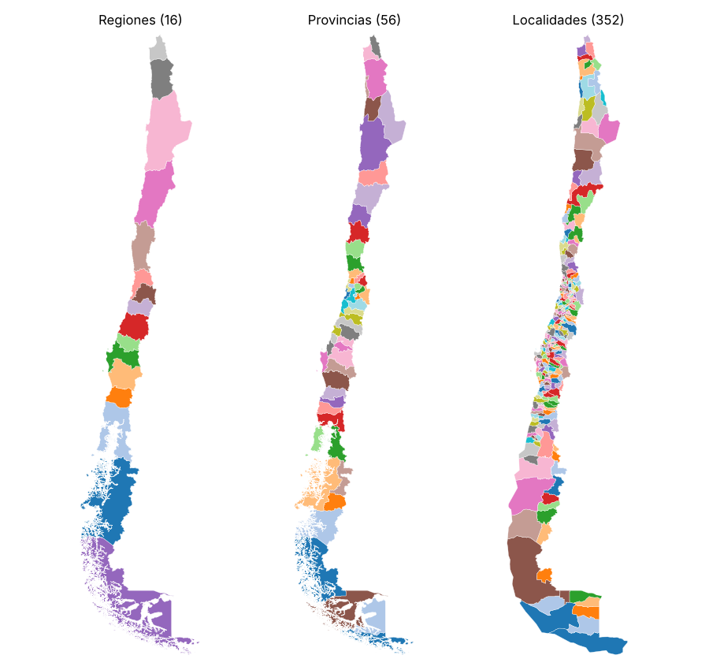

# Límites administrativos de Chile con Overture Maps y DuckDB

Notebook que extrae los límites administrativos de Chile (país, regiones, provincias y comunas) desde **Overture Maps**, consultando directamente los archivos GeoParquet en S3 con **DuckDB**, sin descargar el planeta completo.



## Qué hace

1. Explica el tema `divisions` de Overture y su tipo `division_area` (los polígonos de límites).
2. Propone un reconocimiento visual previo en [Overture Explorer](https://explore.overturemaps.org/).
3. Fija una *release* y conecta DuckDB a S3 (`httpfs` + `spatial`).
4. Inspecciona el esquema y cuenta registros por `subtype` y `class` para `country = 'CL'`.
5. Extrae solo los límites terrestres (`class = 'land'`) y los carga en GeoPandas vía WKB.
6. Dibuja un mapa estático e interactivo (`explore()`).
7. Exporta un archivo por nivel administrativo, en GeoJSON y GeoPackage.

## Resultado

| `subtype` | Equivalente en Chile | Polígonos |
|---|---|---:|
| `country` | País | 1 |
| `region` | Regiones | 16 |
| `county` | Provincias | 56 |
| `locality` | Comunas (aprox.) | 352 |
| `neighborhood` / `microhood` / `macrohood` | Barrios (cobertura parcial) | 390 / 110 / 1 |

Dos cosas que conviene saber:

- En la release usada, Chile **no trae `localadmin`**: el nivel comunal viene como `locality`. Asumir `localadmin` devuelve cero comunas.
- Las 352 `locality` **no calzan 1:1** con las 346 comunas oficiales. Hay que validarlas contra la división oficial (BCN/INE) antes de usarlas como comunas.

## Decisiones técnicas

- **Filtrar por atributo y no por bbox** (`country = 'CL'`), para incluir también Isla de Pascua y Juan Fernández.
- **Solo `class = 'land'`**, para no superponer los polígonos marítimos.
- **Geometría a WKB en SQL** (`ST_AsWKB`), así el resultado pasa a GeoPandas sin archivos intermedios.
- **Fijar la release.** El notebook toma la más reciente; para reproducir un resultado exacto hay que fijarla a mano.

## Cómo ejecutarlo

```bash
pip install duckdb s3fs geopandas shapely matplotlib folium mapclassify
jupyter lab extraccion_limites_administrativos_overture_duckdb.ipynb
```

Los archivos exportados quedan en `chile_limites_administrativos/` (no se versionan: pesan unos 160 MB y se regeneran ejecutando el notebook).

## Licencia y atribución

El código es MIT (ver `LICENSE`). Los datos de Overture Maps se publican bajo ODbL / CDLA-Permissive-2.0 según la capa. Si redistribuyes datos derivados, mantén la atribución: *Contains data from Overture Maps Foundation*, además de las fuentes originales (por ejemplo, OpenStreetMap contributors).

Este trabajo alimenta la serie [Exploring ERA5 · Chile](https://github.com/Zelaznog-J/exploring-era5-chile), que usa el GeoJSON de regiones como máscara de Chile.
